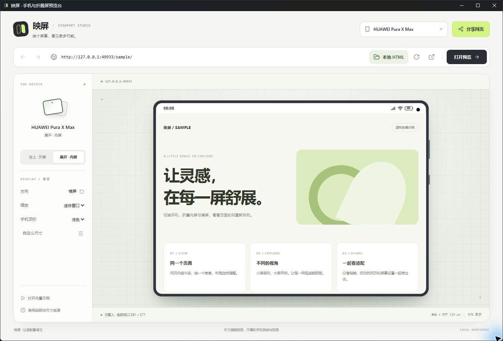

# 映屏 · Yingping Preview

本地网页的手机与折叠屏适配预览工具。打开一次，可以反复切换自己的页面；无需账号、模型密钥或按次数付费。

## 直接给同学使用

1. 在 [最新正式版](https://github.com/Soonerid/yingping-preview/releases/latest) 下载 `yingping-windows-x64.zip`。
2. **完整解压**到一个文件夹，双击 `映屏.exe`。不要只拿走 exe。
3. 输入开发服务器地址，或点「本地 HTML」选择网页、拖入 HTML、粘贴代码。
4. 右上角选手机；左侧切换折叠内外屏、横竖屏、显示比例与手机顶栏。

Windows x64 使用包包含运行时，无需安装 Node.js、Python 或管理员权限。文件夹中的「创建桌面快捷方式.vbs」可创建入口。程序未做商业代码签名；是否允许运行以所在电脑的软件策略为准。

## 测试自己做的页面

- **AI 给了单个 HTML**：点「本地 HTML」选文件，或者直接粘贴 HTML 代码。
- **页面有图片、CSS、JS**：保留整个项目目录，选择项目入口 HTML。资源按入口 HTML 所在目录提供，不开放其上级目录。
- **React / Vue / 需要后端接口**：先启动项目自己的开发服务器，再输入它显示的 HTTP 地址，例如 `http://localhost:3000/`。
- **改完再看**：保存原文件后点「重新读取」；可一直复用这一个工具，无需重新打包映屏。

默认是 HUAWEI Pura X Max 展开内屏，包含华为、Apple、小米、OPPO、vivo、荣耀、三星、一加的参考机型，也可自定义视口。旋转和切屏保留同一个页面的状态。

手机顶栏提供浅色、深色、隐藏三种选择；iPhone 灵动岛、荣耀药丸挖孔、华为折叠内外屏和其他品牌居中打孔分别处理。显示顶栏时，网页按剩余区域排版，底部标注真实网页视口；自定义视口保持纯页面。



## 使用边界

这是 **Windows Chromium 下的网页视口预览**，并非手机操作系统模拟器。尺寸按厂商屏幕像素与参考缩放比换算，可手动校准；机身按键、顶栏与挖孔为比例示意，时间电量是固定示例值，不保证具体系统版本的像素还原。浏览器地址栏不包含在本版顶栏中。正式发布前仍应在真实 Safari、HarmonyOS 或 Android 浏览器上检查。

本体可离线使用。网页自己的 CDN、登录、接口、摄像头或麦克风仍取决于原网站与浏览器权限。无效证书、未启动的服务、网站访问策略不会被绕过。网页版受 iframe 限制，完整的本地项目预览优先使用 Windows 版。

## 隐私

本地 HTML 在本机回环地址提供，不主动上传文件；网页自身的网络请求仍按网页代码执行。预览只读取允许的网页资源，拒绝目录越界、隐藏目录和写请求。本地 HTML 与普通网站使用分开的浏览会话，网站页面没有 Node.js 或任意本机文件权限。仓库和安装包不含预览项目、账号、Cookie、会议数据或密钥。

## 开发和验证

需要 Node.js 22.12+；网页版服务与完整测试另需 Python 3。测试只用标准库，运行结果和临时文件写入 `work/`。

```text
npm test
npm run test:node
npm run dev:web
npm run build:windows
```

Windows 构建首次从官方软件源下载固定版本的 Electron 和打包工具，依赖留在 `work/yingping-desktop-build/`；构建结果在 `outputs/映屏桌面版/`。完整测试包含视口、链接解析、本地资源、隐藏目录／目录越界、页面切换竞态、重复导入和启动冲突。

主要代码：`studio.js / studio.css / devices.js` 是共用界面与设备参数；`desktop/main.cjs` 是原生窗口与隔离边界；`desktop/local-preview.cjs` 提供本地项目资源；`server.py / start_preview.py` 提供轻量网页版。

详情见 [使用说明](使用说明.md)、[继续开发](交给师弟.md)、[对抗性审查记录](对抗性审查.md)。

## 复用许可

项目自有代码使用 [MIT 许可](LICENSE)，可复制、修改、再分发和商业使用，保留许可与版权声明即可。第三方图标、Electron 与 Chromium 的许可分别保留，详见 [第三方声明](THIRD_PARTY_NOTICES.md)。
